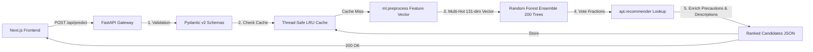

# HealthTrack AI — Backend & Machine Learning Engine

A high-performance, privacy-first REST API and machine learning pipeline for educational symptom assessment built with **FastAPI**, **scikit-learn**, **Pydantic v2**, and **pytest**.

> [!WARNING]
> **Educational Prototype Only — Not for Clinical Use.**
> Results are generated by machine learning models trained on a synthetic, rule-derived dataset and have not been clinically validated. The model's outputs represent decision tree vote distributions, not calibrated disease probabilities. Always consult a licensed medical professional for health guidance. In an emergency, contact local emergency services immediately.

---

## Table of Contents

- [Overview & Architecture](#overview--architecture)
- [Dataset Provenance & Quality Analysis](#dataset-provenance--quality-analysis)
- [Machine Learning Pipeline](#machine-learning-pipeline)
  - [Preprocessing & Tokenization](#preprocessing--tokenization)
  - [Model Training (Random Forest vs Logistic Regression)](#model-training-random-forest-vs-logistic-regression)
  - [Repeated Stratified Cross-Validation (25 Folds)](#repeated-stratified-cross-validation-25-folds)
  - [Why the Dataset Yields 100% Accuracy (Separability Analysis)](#why-the-dataset-yields-100-accuracy-separability-analysis)
- [API Specification](#api-specification)
  - [Interactive Documentation](#interactive-documentation)
  - [Endpoints & Sample Payloads](#endpoints--sample-payloads)
- [Caching & Privacy Architecture](#caching--privacy-architecture)
- [Project Directory Structure](#project-directory-structure)
- [Setup & Execution](#setup--execution)
- [Testing Suite](#testing-suite)

---

## Overview & Architecture

The backend provides real-time probabilistic condition ranking based on user-selected symptoms. It decouples training from live inference, employs strict input validation, logs request latency, and serves responses through an in-memory LRU cache.



---

## Dataset Provenance & Quality Analysis

**Kaggle Source**: [Disease-Symptom Description Dataset](https://www.kaggle.com/datasets/itachi9604/disease-symptom-description-dataset/data)

The underlying data comprises four relational CSV files:
1. `dataset.csv`: 4,920 rows × 18 columns (Disease label + up to 17 symptom slots).
2. `symptom_Description.csv`: Clinical overviews for 41 conditions.
3. `symptom_precaution.csv`: Up to 4 lifestyle / medical precautions per condition.
4. `Symptom-severity.csv`: Reference severity scores (1–7) across 133 symptom terms.

### Deduplication & Overlap Investigation

An exhaustive audit of the raw dataset revealed:

| Metric | Raw Value | Post-Deduplication | Notes |
|---|---|---|---|
| **Total Rows** | 4,920 | **304** | 4,616 duplicate combinations removed |
| **Disease Labels** | 41 | **41** | 100% label retention |
| **Samples per Class** | Exactly 120 | **5 to 10** | Mean: 7.41, Std: 1.70 |
| **Exact Cross-Disease Overlaps** | — | **0** | Every unique symptom set maps to exactly 1 condition |
| **Subset Overlaps** | — | **103 pairs** | One condition's symptoms are a subset of another |
| **Unique Symptoms** | 131 | **131** | Normalized, canonical vocabulary |

> [!IMPORTANT]
> **Data Leakage Prevention**: Splitting the raw 4,920-row dataset would cause 93.8% of test records to be identical duplicates of training records. To eliminate data leakage, all training, splitting, and cross-validation are conducted strictly on the **304 deduplicated samples**.

---

## Machine Learning Pipeline

### Preprocessing & Tokenization

Preprocessing is governed by [`ml/preprocess.py`](ml/preprocess.py):
- **Normalization**: Strips whitespace, converts to lowercase, replaces spaces and hyphens with underscores, and maps recognized aliases (e.g., `dischromic__patches` $\rightarrow$ `dischromic_patches`).
- **Canonical Vocabulary**: The 131 symptoms are fixed in an ordered vocabulary serialized to [`ml/models/vocab.json`](ml/models/vocab.json).
- **Feature Vector**: Inference maps incoming symptoms into a 131-dimensional binary multi-hot vector ($x_i \in \{0, 1\}$).

### Model Training (Random Forest vs Logistic Regression)

Two supervised models were benchmarked on the deduplicated dataset:
1. **Random Forest Classifier (Primary)**: `n_estimators=200`, `random_state=42`, `n_jobs=-1`. Selected for its native ability to output ensemble vote distributions (`predict_proba`).
2. **Logistic Regression (Baseline)**: Multiclass `lbfgs` solver, $C=1.0$, `max_iter=2000`.

### Repeated Stratified Cross-Validation (25 Folds)

To verify evaluation stability across varied splits, we executed Repeated Stratified K-Fold Cross Validation (`RepeatedStratifiedKFold(n_splits=5, n_repeats=5, random_state=42)`):

| Model | Mean Accuracy | Std Dev | Mean Macro F1 | Std Dev | Total Misclassifications |
|---|---|---|---|---|---|
| **Random Forest** | **1.0000** | **0.0000** | **1.0000** | **0.0000** | **0 / 1,520** (0.00%) |
| **Logistic Regression** | **1.0000** | **0.0000** | **1.0000** | **0.0000** | **0 / 1,520** (0.00%) |

#### Class Count Constraint & Fold Limitations
- Eight classes have exactly 5 deduplicated records (*Fungal infection, Allergy, AIDS, Gastroenteritis, Paralysis, Heart attack, Acne, Urinary tract infection*).
- **Limitation**: $K = 5$ is the maximum valid stratified K-fold configuration. A 10-fold stratified CV cannot be run because classes with 5 samples cannot be partitioned across 10 folds with stratification.

### Why the Dataset Yields 100% Accuracy (Separability Analysis)

An empirical inspection reveals why linear models and decision trees achieve 100% accuracy on this dataset:
1. **80 of 131 symptoms (61.1%) are pathognomonic**: They appear in one and only one disease.
2. **32 of the 41 diseases** contain at least one symptom unique to that disease.
3. **Orthogonal separation for remaining diseases**: The 9 conditions without an exclusive symptom have distinct combinations with a **minimum Hamming distance of 2.0** (at least two binary feature differences from any other condition).
4. **Zero Label Noise**: The synthetic dataset was constructed from deterministic clinical textbook rules without patient reporting noise.

---

## API Specification

### Interactive Documentation

Once the server is running, interactive Swagger and ReDoc interfaces are accessible at:
- **Swagger UI**: [http://localhost:8000/docs](http://localhost:8000/docs)
- **ReDoc**: [http://localhost:8000/redoc](http://localhost:8000/redoc)

### Endpoints & Sample Payloads

#### 1. System Health Check
`GET /api/health`

```bash
curl -X GET http://localhost:8000/api/health
```

**Response (200 OK):**
```json
{
  "status": "ok",
  "model_loaded": true,
  "model_version": "rf_v1",
  "vocabulary_size": 131
}
```

#### 2. Symptom Vocabulary List
`GET /api/symptoms`

```bash
curl -X GET http://localhost:8000/api/symptoms
```

**Response (200 OK):**
```json
{
  "symptoms": [
    "abdominal_pain",
    "abnormal_menstruation",
    "acidity",
    "acute_liver_failure",
    "altered_sensorium",
    "itching",
    "skin_rash"
  ]
}
```

#### 3. Symptom Assessment & Prediction
`POST /api/predict`

```bash
curl -X POST http://localhost:8000/api/predict \
  -H "Content-Type: application/json" \
  -d '{
    "symptoms": ["itching", "skin_rash", "nodal_skin_eruptions"]
  }'
```

**Response (200 OK):**
```json
{
  "candidates": [
    {
      "rank": 1,
      "condition": "Fungal infection",
      "score": 0.77,
      "score_label": "model_vote_fraction",
      "description": "In humans, fungal infections occur when an invading fungus takes over an area of the body...",
      "precautions": [
        "bath twice",
        "use detol or neem in bathing water",
        "keep infected area dry",
        "use clean cloths"
      ],
      "matching_symptoms": [
        "itching",
        "skin_rash",
        "nodal_skin_eruptions"
      ]
    },
    {
      "rank": 2,
      "condition": "Drug Reaction",
      "score": 0.07,
      "score_label": "model_vote_fraction",
      "description": "An adverse drug reaction (ADR) is an injury caused by taking medication...",
      "precautions": [
        "stop irritation",
        "consult nearest hospital",
        "stop taking drug",
        "follow up"
      ],
      "matching_symptoms": [
        "itching",
        "skin_rash"
      ]
    }
  ],
  "known_symptoms": [
    "itching",
    "skin_rash",
    "nodal_skin_eruptions"
  ],
  "unknown_symptoms": [],
  "model_version": "rf_v1",
  "disclaimer": "This tool is an educational prototype and does not provide medical advice...",
  "uncertainty_note": "Scores reflect how the Random Forest model distributes votes among its decision trees..."
}
```

#### Error Responses
- **422 Unprocessable Entity**: Empty symptom list or all symptoms unrecognized.
- **503 Service Unavailable**: Model artifact not loaded (run training first).

---

## Caching & Privacy Architecture

- **Thread-Safe In-Memory Cache**: Implemented in [`api/cache.py`](api/cache.py) using an LRU policy with an `OrderedDict` guarded by a `threading.Lock`.
- **Cache Key**: Structured as `(model_version, tuple(sorted(canonical_symptoms)))`.
- **Zero Persistent Storage**: No patient health queries, IP addresses, or symptom histories are ever persisted to disk or databases.
- **Privacy by Design**: Logs record only HTTP method, endpoint path, status code, and latency in milliseconds.

---

## Project Directory Structure

```
backend/
├── api/
│   ├── main.py            # FastAPI entry point, lifespan, CORS, and request logging
│   ├── routes.py          # /api/health, /api/symptoms, /api/predict routes
│   ├── schemas.py         # Pydantic v2 request and response contracts
│   ├── model_loader.py    # Thread-safe model artifact singleton
│   ├── recommender.py     # Descriptions, precautions, and symptom overlap matcher
│   └── cache.py           # Thread-safe in-memory LRU prediction cache
├── ml/
│   ├── preprocess.py      # Normalization, tokenization, and multi-hot vector encoding
│   ├── train.py           # Training pipeline (RF vs LR), deduplication, metrics export
│   ├── evaluate_cv.py     # Repeated stratified cross-validation and Hamming analysis
│   └── models/            # Serialized model artifacts
│       ├── rf_model.joblib # Trained Random Forest model + LabelEncoder
│       ├── vocab.json     # Ordered 131-symptom vocabulary
│       └── metrics.json   # Comprehensive training & CV evaluation metrics
├── data/                  # Read-only copies of source CSV files
├── tests/
│   ├── test_api.py        # API endpoint integration and error handling tests
│   ├── test_preprocess.py # Vocabulary encoding, normalization, and edge case tests
│   ├── test_cache.py      # Cache eviction, hit/miss, and thread safety tests
│   └── test_recommender.py# Condition lookup and precaution fallback tests
├── conftest.py            # Shared pytest fixtures
└── requirements.txt       # Production & testing dependencies
```

---

## Setup & Execution

### 1. Environment Setup

```bash
cd "HealthTrack AI/backend"

# Create and activate virtual environment
python3 -m venv .venv
source .venv/bin/activate       # On Windows: .venv\Scripts\activate

# Install dependencies
pip install -r requirements.txt
```

### 2. Train the Machine Learning Pipeline

```bash
# Runs deduplication, model training, and metrics serialization
python3 -m ml.train
```

### 3. Run Repeated Cross-Validation Benchmark

```bash
# Runs 5x5 Repeated Stratified Cross-Validation (25 folds)
python3 -m ml.evaluate_cv
```

### 4. Start the FastAPI Production Server

```bash
# Starts Uvicorn on port 8000 with auto-reload
uvicorn api.main:app --reload --port 8000
```

---

## Testing Suite

Run the full automated test suite using `pytest`:

```bash
cd "HealthTrack AI/backend"
pytest -v
```

### Test Coverage Summary (66 Tests Passing):
- **API Tests (`tests/test_api.py`)**: 21 tests verifying health checks, valid predictions, candidate-specific matched symptoms, 422 validations for empty or unrecognized symptoms, CORS headers, and response schema contracts.
- **Preprocessing Tests (`tests/test_preprocess.py`)**: 27 tests checking symptom whitespace trimming, alias resolution, unseen input rejection, feature vector dimensionality, and round-trip consistency.
- **Cache Tests (`tests/test_cache.py`)**: 8 tests validating LRU capacity eviction, cache hits, cache misses, stats reporting, and version invalidation.
- **Recommender Tests (`tests/test_recommender.py`)**: 10 tests validating description lookups, precaution arrays, disease symptom mapping, candidate matching symptoms, and missing data fallbacks.
