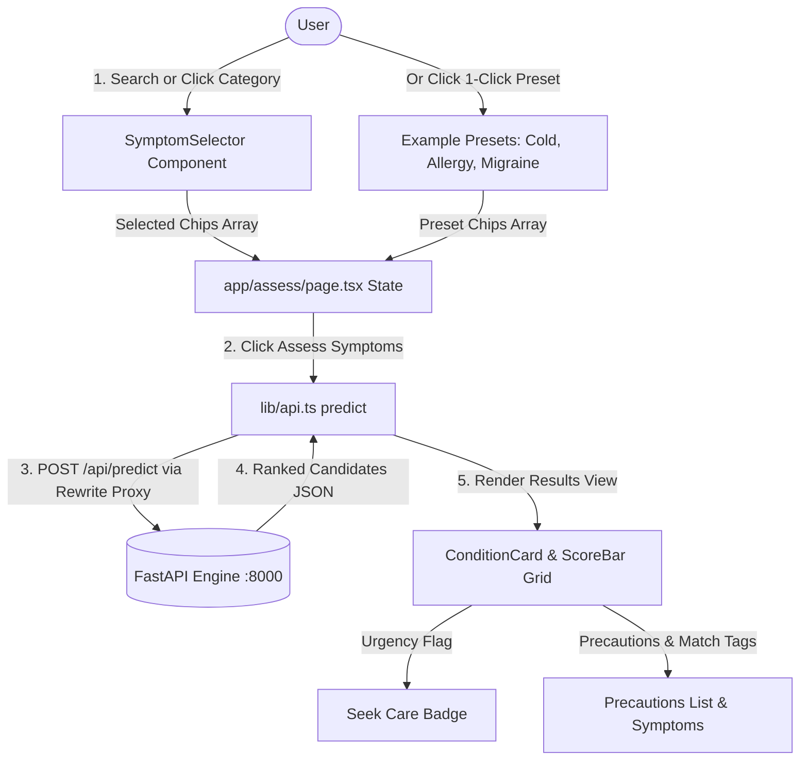

# HealthTrack AI — Frontend Application

A state-of-the-art, responsive web application for educational symptom assessment built with **Next.js 16 (App Router & Turbopack)**, **React 19**, **TypeScript 5**, **Tailwind CSS v4**, and **Vitest**.

> [!WARNING]
> **Educational Prototype Only — Not for Clinical Use.**
> This application is an educational prototype and does not provide medical advice, diagnosis, or treatment. Always consult a qualified medical professional for health concerns. In an emergency, call your local emergency services immediately.

---

## Table of Contents

- [Overview & User Experience](#overview--user-experience)
- [Key Features](#key-features)
- [Tech Stack & Architecture](#tech-stack--architecture)
  - [Next.js Turbopack & API Proxy](#nextjs-turbopack--api-proxy)
  - [Tailwind CSS v4 Design System](#tailwind-css-v4-design-system)
- [Directory Structure](#directory-structure)
- [Environment Configuration](#environment-configuration)
- [Getting Started & Scripts](#getting-started--scripts)
- [Testing Suite (Vitest & RTL)](#testing-suite-vitest--rtl)
- [Troubleshooting & FAQs](#troubleshooting--faqs)

---

## Overview & User Experience

HealthTrack AI delivers an intuitive, accessible clinical assessment interface. Users can search and filter across 131 standardized clinical symptoms, test realistic 1-click clinical scenarios, review ranked conditions with ensemble vote fractions, and inspect recommended precautions alongside emergency safety flags.



---

## Key Features

### 1. Multi-Modal Symptom Selection
- **Typeahead Instant Search**: Fast, keyboard-navigable autocomplete filtering through 131 canonical symptom terms.
- **Categorized Clinical Browsing**: Organized into clinical categories for instant 1-tap toggling:
  - 🌟 **Common Symptoms**: *Fatigue, High fever, Headache, Cough, Nausea, Chills...*
  - 🫁 **Respiratory**: *Breathlessness, Continuous sneezing, Phlegm, Chest pain, Sinus pressure...*
  - 🍽️ **Digestive**: *Abdominal pain, Acidity, Indigestion, Vomiting, Diarrhoea...*
  - 🧠 **Neuro & Body**: *Headache, Joint pain, Muscle pain, Dizziness, Altered sensorium...*
  - 🧬 **Skin & Allergy**: *Itching, Skin rash, Blister, Pimples, Red sores...*
- **1-Click Test Scenarios**: Quick-test buttons for realistic clinical presentations (*Common Cold*, *Allergic Reaction*, *Migraine Attack*, *Skin Infection*).

### 2. Ranked Condition Insights
- **Top Match Hero Card**: Visual primary match callout with custom gradient rank badges (`#1 Primary Match`).
- **Ensemble Vote Progress Bar**: Visual model score percentage bar with accessible ARIA progressbar attributes.
- **Matched Symptom Attribution**: Distinct tags identifying exactly which user-selected symptoms contributed to each candidate.
- **Clinical Precautions & Overviews**: Actionable lifestyle and medical precautions with visual indicators for emergency actions.
- **Emergency / Acute Warning Badges**: Automatic visual flags ("Seek care") for high-urgency conditions (*Heart attack, Paralysis, AIDS, Pneumonia, Tuberculosis*).

### 3. Safety, Privacy & Accessibility
- **Transparent Model Attribution**: Clear distinction between recognized and unrecognized symptom terms.
- **Prominent Medical Disclaimer**: Prominently displayed warning banners across all views.
- **Print & Export Summary**: One-click print-ready styling for discussing assessments with healthcare providers.
- **Zero Tracking**: 100% in-memory client queries; no cookies, analytics trackers, or third-party diagnostic services.

---

## Tech Stack & Architecture

- **Framework**: [Next.js 16](https://nextjs.org/) (App Router, Turbopack, React 19)
- **Language**: [TypeScript 5](https://www.typescriptlang.org/) (Strict mode, fully typed API contracts)
- **Styling**: [Tailwind CSS v4](https://tailwindcss.com/) with PostCSS integration
- **Icons**: Semantic SVG icons with explicit layout dimensions to prevent layout shifts
- **Unit & Integration Testing**: [Vitest](https://vitest.dev/) with [React Testing Library](https://testing-library.com/) & [jsdom](https://github.com/jsdom/jsdom)

### Next.js Turbopack & API Proxy

To eliminate cross-origin resource sharing (CORS) issues and port mismatches between the frontend (`:3000`) and backend (`:8000`), [`next.config.ts`](next.config.ts) defines an automatic rewrite proxy:

```typescript
// next.config.ts
const nextConfig: NextConfig = {
  async rewrites() {
    return [
      {
        source: "/api/:path*",
        destination: "http://localhost:8000/api/:path*",
      },
    ];
  },
};
```

This allows [`lib/api.ts`](lib/api.ts) to communicate seamlessly via relative `/api/...` endpoints in the browser while supporting direct environment variable overrides in SSR or staging.

### Tailwind CSS v4 Design System

Tailwind v4 is configured via [`postcss.config.mjs`](postcss.config.mjs) and [`app/globals.css`](app/globals.css):
- Uses modern CSS variable theming with HSL color tokens.
- Glassmorphic card styling with `backdrop-blur-md bg-white/95 border-slate-200/90`.
- Curated gradients: Teal-to-Cyan for primary actions, Blue-to-Indigo for secondary ranks, Amber for medical warnings, and Rose for acute care alerts.

---

## Directory Structure

```
frontend/
├── app/
│   ├── layout.tsx         # Root layout: Inter font, SEO metadata, theme wrapper
│   ├── page.tsx           # HealthTrack AI landing page, hero, 3-step workflow, features
│   ├── assess/
│   │   └── page.tsx       # Core symptom assessment & ranked results page
│   └── globals.css        # Tailwind v4 imports and theme variables
├── components/
│   ├── SymptomSelector.tsx # Typeahead search, category pills, presets, and chip manager
│   ├── ConditionCard.tsx   # Condition card: ranking, score bar, precautions, match tags
│   ├── ScoreBar.tsx        # Accessible vote-fraction progress bar & percentage badge
│   └── Disclaimer.tsx      # Prominent medical safety and prototype warning banner
├── hooks/
│   └── useAssessment.ts    # Reusable assessment state management hook
├── lib/
│   ├── api.ts              # Typed backend API client (getSymptoms, predict, checkHealth)
│   └── utils.ts            # Class merging utility (clsx + tailwind-merge)
├── types/
│   └── api.ts              # TypeScript interfaces matching FastAPI Pydantic schemas
├── __tests__/
│   ├── api.test.ts         # Vitest unit tests for API client and error handling
│   └── components.test.tsx # Component rendering, RTL interaction, and accessibility tests
├── postcss.config.mjs      # Tailwind CSS v4 PostCSS plugin configuration
├── next.config.ts          # Next.js configuration with security headers & API rewrites
├── vitest.config.mts       # Vitest configuration with jsdom & path aliases
├── vitest.setup.ts         # Vitest setup file (@testing-library/jest-dom)
├── tsconfig.json           # TypeScript configuration
└── package.json            # Scripts and dependencies
```

---

## Environment Configuration

Configure [`frontend/.env.local`](.env.local) if targeting a remote backend host:

```env
# Optional: defaults to relative /api proxy or http://localhost:8000
NEXT_PUBLIC_API_URL=http://localhost:8000
```

---

## Getting Started & Scripts

### 1. Install Dependencies

```bash
cd "HealthTrack AI/frontend"
npm install
```

### 2. Run Development Server (Turbopack)

```bash
npm run dev
```
Open [http://localhost:3000](http://localhost:3000) to view the application.

### 3. Run Production Build

```bash
# Validates TypeScript, static generation, and bundles production assets
npm run build

# Runs production server locally
npm start
```

### 4. Run Test Suite

```bash
# Executes all unit and component test suites in jsdom
npm test
```

---

## Testing Suite (Vitest & RTL)

All frontend components and client functions are covered by automated tests in [`frontend/__tests__/`](__tests__/):

```bash
npm test
```

### Test Coverage Breakdown (11 Tests Passing):

#### 1. API Client Suite ([`__tests__/api.test.ts`](__tests__/api.test.ts) - 4 tests)
- `getSymptoms`: Verifies symptom vocabulary fetching and header serialization.
- `predict`: Tests submission of symptom arrays and deserialization of candidate condition arrays.
- `checkHealth`: Validates system status verification and model version checks.
- `HTTP Error Handling`: Ensures backend 422 error details are extracted and converted to user-friendly exceptions.

#### 2. Components Suite ([`__tests__/components.test.tsx`](__tests__/components.test.tsx) - 7 tests)
- `Disclaimer`: Confirms prominent rendering of emergency contact warnings and prototype alerts.
- `ScoreBar`: Verifies ARIA `progressbar` attributes (`aria-valuenow`, `aria-valuemin`, `aria-valuemax`) and score formatting.
- `ConditionCard`: Tests candidate title, rank `#1` badge, description, precaution lists, and matching symptom chips.
- `ConditionCard (Urgency)`: Tests rendering of the "Seek care" alert badge for critical conditions.
- `SymptomSelector (Search & Filter)`: Validates that typing into the search input dynamically filters dropdown suggestions.
- `SymptomSelector (Add Symptom)`: Tests that clicking a symptom in the dropdown triggers `onAdd` with the canonical identifier.
- `SymptomSelector (Remove Symptom)`: Verifies that clicking the remove button on a selected tag triggers `onRemove`.

---

## Troubleshooting & FAQs

### Why was `@tailwindcss/postcss` needed?
Next.js 16 with Tailwind CSS v4 requires `@tailwindcss/postcss` in `postcss.config.mjs` to parse `@import "tailwindcss";` in `globals.css`. Without this configuration, utility classes are omitted from the generated CSS, resulting in unstyled HTML and oversized SVGs.

### Why do requests go to `/api/...` instead of `http://localhost:8000`?
Next.js rewrites in `next.config.ts` automatically forward `/api/:path*` to `http://localhost:8000/api/:path*`. This eliminates browser CORS preflight restrictions, prevents mixed-content warnings, and ensures seamless development across different host environments.
